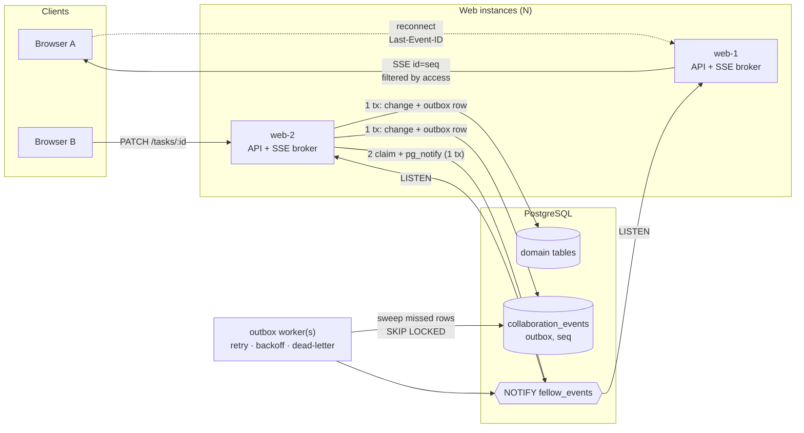

# Fellow

[](https://github.com/vbhvx/Fellow/actions/workflows/ci.yml)

A multi-tenant project collaboration platform: organizations, role-based access, private projects, a realtime Kanban board, comments, activity history, notifications, and search.

The UI is ordinary. The interesting part is the backend, which is built to stay **correct under concurrency and horizontal scale**: many users dragging the same cards, many web instances, many workers, and crashes at the worst possible moment.

**Stack:** Next.js 14 (App Router) · TypeScript · PostgreSQL 16 · Drizzle ORM · Zod · Server-Sent Events · Vitest · Docker · GitHub Actions

---

## Engineering highlights

| Problem | Solution | Proven by |
|---|---|---|
| Realtime must work across **multiple app instances** | Transactional outbox → `pg_notify` → a `LISTEN` connection on every instance → per-instance SSE broker | `tests/realtime/event-delivery.test.ts`, `sse-stream.test.ts`, and a 2-replica `docker compose` stack |
| A crash between commit and broadcast must not **lose events** | Outbox relay worker with `FOR UPDATE SKIP LOCKED`, exponential backoff, and dead-lettering | Exactly-once relay race test; retry and dead-letter test |
| Clients that disconnect must not **miss events** | Global `seq` used as the SSE id; `Last-Event-ID` replay; `system.resync` when too far behind | SSE replay test (ordering, de-duplication, authorization) |
| Two users editing the **same task** | Optimistic concurrency (`version`, compare-and-swap `UPDATE … WHERE version = $n`) → 409 | `tests/concurrency/concurrency.test.ts` |
| Two users dropping cards into the **same slot** | Per-column row lock + server-derived neighbours + fractional indexing with rebalancing | `tests/concurrency/ordering.test.ts` (fails if the lock is removed) |
| **Tenant isolation**, including for realtime | Central policy module; one `canReceive()` shared by live delivery and replay; 404 instead of 403 to avoid leaking existence | `tests/security/tenant-isolation.test.ts` |
| Brute force / credential stuffing | Postgres-backed rate limits per IP and per account (exact under concurrency); constant-time login for unknown emails | `tests/security/rate-limit.test.ts` |
| Schema drift between ORM and DB | Versioned SQL migrations with checksums + advisory lock; a test diffing Drizzle against `information_schema` | `tests/db/schema-drift.test.ts` |

The tests run against a real Postgres, not mocks. The concurrency and relay tests are mutation-checked: removing the column lock or `SKIP LOCKED` makes them fail.

## Architecture



Request path: **auth** (JWT cookie or bearer) → **authorization** (`src/server/authorization/permissions.ts`) → **validation** (Zod) → **service** (one transaction: change + activity log + notification + outbox event) → **relay**.

Deeper write-ups:

- [docs/realtime-events.md](docs/realtime-events.md): delivery guarantees, the relay, replay, backpressure
- [docs/ordering-strategy.md](docs/ordering-strategy.md): fractional indexing, rebalancing, column locking
- [docs/tenant-isolation.md](docs/tenant-isolation.md) and [docs/authorization-matrix.md](docs/authorization-matrix.md)
- [docs/architecture.md](docs/architecture.md)
- API reference: `/docs` (rendered) and `/api/v1/openapi.json`

## Running it

### Option A: the whole stack in Docker

This runs Postgres, migrations, **two** web replicas behind nginx round-robin, and the worker:

```bash
JWT_SECRET=$(openssl rand -hex 32) docker compose up --build
open http://localhost:8080
```

To see cross-instance realtime, open the same board in two tabs. Their SSE connections land on different replicas, and moves made in one appear in the other.

### Option B: local development

Requires Node 20+ and PostgreSQL 14+.

```bash
npm install
cp .env.example .env          # set DATABASE_URL, TEST_DATABASE_URL, JWT_SECRET
npm run db:migrate
npm run db:seed               # optional demo data (alice@acme.com / password123)
npm run dev                   # http://localhost:3000
npm run worker:outbox         # in another terminal
```

## Testing

```bash
npm test                  # all suites (needs TEST_DATABASE_URL, a separate database)
npm run test:concurrency  # optimistic locking, ordering races
npm run test:realtime     # outbox relay, NOTIFY bus, SSE replay
npm run test:security     # tenant isolation, rate limiting
npm run verify            # typecheck + lint + tests (what CI runs, plus a production build)
```

CI (`.github/workflows/ci.yml`) runs typecheck, lint, migrations applied twice to prove idempotency, the full test suite against a Postgres service container, a production build, and Docker image builds.

## Operations

| Concern | Implementation |
|---|---|
| Config | `src/server/config/env.ts` validates with Zod at boot. In production, an invalid config exits the process instead of serving 500s. |
| Migrations | `src/db/migrations/NNNN_*.sql`, applied in order under a Postgres advisory lock (safe with concurrent deploys). Editing an applied migration is detected by checksum and refused. |
| Health | `GET /api/v1/health/live` (liveness, no dependencies). `GET /api/v1/health` (readiness: DB latency, bus state, outbox backlog/age, dead letters → `degraded`). |
| Logging | Structured JSON lines (`src/server/observability/logger.ts`). Every API response carries `x-request-id`, which is echoed in error bodies and logs. |
| Security headers | CSP, HSTS, `X-Frame-Options: DENY`, `nosniff`, Referrer-Policy, Permissions-Policy (`next.config.mjs`). |
| Resilience | Pool error handler (an idle-connection error no longer crashes the process), 15s statement timeout, worker graceful shutdown on SIGTERM. |
| Data retention | The worker prunes delivered events after 7 days (the replay window) and expired rate-limit windows. |

### Deployment notes

- **Vercel / serverless:** the API and SSE routes run on Fluid Compute. Run the outbox worker somewhere long-lived (a container, Fly.io, Railway, or a small VM). Each web instance holds one `LISTEN` connection, so use a direct (non-transaction-pooled) Postgres URL or a session-mode pooler.
- **Rate limiting** trusts the first `X-Forwarded-For` hop. That is correct behind Vercel or the bundled nginx (which overwrites the header). Behind other proxies, make sure they do the same.

## Project layout

```
src/
  app/api/v1/          REST + SSE route handlers (thin: auth → validate → service)
  server/
    services/          domain logic, one transaction per use case
    authorization/     RBAC + project-visibility policy
    events/outbox.ts   transactional outbox + relay
    realtime/          LISTEN/NOTIFY bus, per-instance SSE broker
    ordering/          fractional indexing
    security/          rate limiting
    config/ observability/ errors/ validation/
  db/                  Drizzle schema, versioned SQL migrations, runner, seed
  lib/                 client-side API + realtime hook
workers/outbox/        relay worker
tests/                 unit, integration, security, concurrency, realtime, db
deploy/                nginx config for the multi-replica compose stack
```

## Trade-offs and what I'd do next

- **Postgres as the message bus.** This avoids running Redis or Kafka, and NOTIFY is transactional, which is exactly what an outbox wants. It is fine up to thousands of events per second. Past that, swap `src/server/realtime/bus.ts` for Redis Streams or NATS partitioned by organization; the rest of the pipeline is unchanged.
- **Stateless JWT sessions** can't be revoked before expiry (7 days). The next step is a `token_version` column checked on each request, or short-lived access tokens plus refresh rotation.
- **Fixed-window rate limits** allow a burst of up to twice the limit at window edges. A sliding window or GCRA would be smoother, but for login protection a fixed window is adequate.
- **End-to-end browser tests** (Playwright) for the drag-and-drop flow are not written yet.
